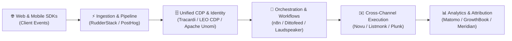

# 🚀 Awesome Enterprise Marketing Automation

### 🏆 Curated Directory of Enterprise SaaS Suites, Open-Source CDPs & Cross-Channel Campaign Orchestration Engines

  
  
  
  
  

  <b>A comprehensive, production-grade guide for Growth Architects, MarTech Engineers, CRM Administrators, and Enterprise Marketing Teams.</b>

---

## 📌 Executive Summary & Architecture Scope

**Enterprise Marketing Automation** represents the core software infrastructure that enables organizations to aggregate first-party customer profiles, compute predictive behavioral segments, orchestrate complex multi-stage omni-channel customer journeys, and measure revenue attribution at enterprise scale.

This repository catalogs:
- 🏢 **Enterprise SaaS Giants**: Mission-critical suites powering Global 2000 customer acquisition, retention, and decisioning.
- 🔓 **Open-Source & Composable Platforms**: Self-hosted customer data platforms (CDPs), event streaming pipelines, and execution engines designed for total data sovereignty, privacy compliance, and cost efficiency.

---

## 📑 Table of Contents

- [🌐 Sector Overview & Market Dynamics](#-sector-overview--market-dynamics)
- [🏢 Enterprise SaaS & Hosted Platforms](#-enterprise-saas--hosted-platforms)
- [🔓 Open-Source GitHub Projects (Ranked by Stars)](#-open-source-github-projects-ranked-by-stars)
- [🧩 Composable MarTech Reference Architecture](#-composable-martech-reference-architecture)
- [🎯 SEO & Keyword Taxonomy](#-seo--keyword-taxonomy)
- [🤝 How to Contribute](#-how-to-contribute)
- [🛡️ Legal & Compliance Disclaimer](#️-legal--compliance-disclaimer)
- [📈 Star History](#-star-history)
- [💖 Support & Community](#-support--community)

---

## 🌐 Sector Overview & Market Dynamics

> 📊 **Estimated Market Size**: The global Marketing Automation Software and Customer Data Platform (CDP) market is valued at **$7.5 Billion to $9.2 Billion in 2025–2026** and is projected to expand to **$18.5+ Billion by 2030**, reflecting a compound annual growth rate (CAGR) of **13.6%**.
>
> 🔄 **Market Concentration & Competitive Dynamics**: The sector is characterized by **moderate fragmentation with a bifurcated "barbell" structure**. At the enterprise high end, an oligopoly of mega-cap enterprise incumbents (Oracle, Salesforce, Adobe) dominates legacy all-in-one CRM/MarTech suites. Simultaneously, agile best-of-breed cross-channel platforms (Braze, Iterable, Klaviyo) and high-performance open-source, developer-first frameworks (n8n, Twenty, PostHog, Mautic, Listmonk) are rapidly capturing market share through composable architectures, privacy-first data sovereignty, and AI agent automation.

---

## 🏢 Enterprise SaaS & Hosted Platforms

Below is the curated breakdown of enterprise SaaS marketing automation suites, sorted in **descending order by company valuation / market capitalization**.

| 🏢 Platform | 💰 Company Size (Valuation / Revenue) | 🏷️ Starting Tier Price | 🎁 Free Tier / Trial Limits | ⚡ Core Enterprise Capabilities |
| :--- | :--- | :--- | :--- | :--- |
| **[Oracle Marketing Cloud Eloqua](https://www.oracle.com/cx/marketing/automation/)** | **~$460 Billion Market Cap** *(Oracle Corp, ~$53B ARR)* | **$2,000 / month** *(Basic Edition, billed annually, up to 10k contacts)* | **No free plan**; 30-day proof-of-concept (POC) sandbox provisioned on enterprise sales request | B2B lead scoring, multi-stage nurturing canvas, revenue attribution, deep Oracle Siebel/Sales Cloud sync |
| **[Salesforce Marketing Cloud](https://www.salesforce.com/products/marketing-cloud/overview/)** | **~$310 Billion Market Cap** *(Salesforce Inc, ~$38B ARR)* | **$1,500 / month** *(Growth)* / **$3,250 / month** *(Advanced Edition, billed annually)* | **No free plan**; 30-day guided evaluation sandbox available via enterprise sales representative | Journey Builder, Email Studio, Data 360, Einstein Predictive AI, Agentforce autonomous campaign optimization |
| **[Adobe Experience Cloud](https://business.adobe.com/)** | **~$210 Billion Market Cap** *(Adobe Inc, ~$21.5B ARR)* | **$2,000 / month** *(Adobe Campaign entry tier, billed annually)* | **No free plan**; 30-day enterprise proof-of-concept (POC) environment upon sales consultation | Adobe Campaign, Real-Time CDP, cross-channel journey orchestration, enterprise asset management |
| **[Marketo Engage](https://business.adobe.com/products/marketo/marketo-engage.html)** | **~$210B Parent Market Cap** *(Adobe Unit, acquired for $4.75B)* | **$1,295 / month** *(Select tier, billed annually, up to 10k database records)* | **No free plan**; 14-day interactive guided trial and demo sandbox on request | Enterprise B2B marketing automation, account-based marketing (ABM), lead lifecycle modeling, Bizible attribution |
| **[HubSpot Marketing Hub Enterprise](https://www.hubspot.com/pricing/marketing)** | **~$32 Billion Market Cap** *(HubSpot Inc, ~$2.5B ARR)* | **$3,600 / month** *(Enterprise tier billed annually, includes 10k marketing contacts)* | **Free forever plan** *(up to 5 active lists, 2,000 email sends/month, 1 form, basic CRM contacts)* | Multi-touch revenue attribution, custom behavioral event triggers, predictive lead scoring, omni-channel workflows |
| **[Zeta Global](https://zetaglobal.com/)** | **~$8.3 Billion Market Cap** *(Zeta Global Corp, ~$1.57B ARR)* | **$5,833 / month** *(~$70,000/year base annual contract value)* | **No free plan**; 14-to-30 day POC sandbox environment during enterprise onboarding | Identity resolution (2.4B+ profiles), AI-driven customer acquisition, omnichannel programmatic activation |
| **[Pegasystems Marketing](https://www.pega.com/products/decision-hub)** | **~$5.6 Billion Market Cap** *(Pegasystems Inc, ~$1.75B ARR)* | **$2,600 / month** *(Based on enterprise minimum of named users at ~$260/user/mo)* | **No free plan**; 30-day guided enterprise test environment upon sales evaluation | Customer Decision Hub (CDH), real-time "Next-Best-Action" AI engine, predictive customer lifetime journey optimization |
| **[Braze](https://www.braze.com/)** | **~$3.1 Billion Market Cap** *(Braze Inc, ~$780M ARR)* | **$2,500 / month** *(~$30,000/year base tier, up to 10k Monthly Active Users)* | **14-day free trial** *(guided sandbox with campaign templates, no credit card required); 4-month free tier for eligible startups* | Canvas Journey Builder, cross-channel mobile/web push, in-app messaging, real-time streaming audience segmentation |
| **[Iterable](https://iterable.com/)** | **~$2.0 Billion Valuation** *(Private Unicorn, ~$240M ARR)* | **$500 / month** *(Base startup tier billed annually for up to 10k contacts)* | **No free plan**; 14-day guided proof-of-concept sandbox upon sales evaluation | Visual cross-channel workflow builder, Nova AI predictive optimization, unified profile segmentation, developer-first SDKs |
| **[Bloomreach Engagement](https://www.bloomreach.com/en/products/engagement)** | **~$1.0 Billion Valuation** *(Private Unicorn, ~$150M ARR)* | **$1,500 / month** *(App store baseline)* / **$4,166 / month** *(Enterprise suite)* | **No free plan**; 14-day scoping sandbox available during enterprise sales pilot | Commerce-focused CDP, real-time behavioral segmentation, AI product recommendations, omnichannel SMS/email |
| **[Acoustic Campaign](https://acoustic.com/)** | **~$500 Million Valuation** *(Private Equity backed, ~$120M ARR)* | **$900 / month** *(Professional tier billed annually based on messaging volume)* | **No free plan**; 14-to-30 day guided demonstration sandbox via solution engineering request | Enterprise email and SMS lifecycle automation, deliverability optimization, AI content assistant, behavioral triggers |

---

## 🔓 Open-Source GitHub Projects (Ranked by Stars)

Each open-source repository below includes a real-time star badge linking to its GitHub stargazers page. Repositories are strictly sorted in **descending order of star count**.

### 1. [n8n](https://github.com/n8n-io/n8n) 
- **Primary Focus**: Fair-code workflow automation and orchestration with native AI agents.
- **License**: Sustainable Use License / Fair-code
- **Why It Matters**: Often dubbed the open-source alternative to Zapier and Make, n8n enables engineering teams to build sophisticated event-driven marketing workflows, sync CRM pipelines, and integrate with 400+ SaaS services with self-hosted sovereignty.

### 2. [Twenty](https://github.com/twentyhq/twenty) 
- **Primary Focus**: The modern open-source CRM alternative to Salesforce, built for AI.
- **License**: AGPL-3.0
- **Why It Matters**: Features custom object modeling, relational customer views, Kanban pipelines, and GraphQL/REST APIs to store unified customer records and power downstream automation.

### 3. [PostHog](https://github.com/PostHog/posthog) 
- **Primary Focus**: Product analytics, feature flags, web analytics, session replay, and CDP.
- **License**: MIT / Proprietary
- **Why It Matters**: Provides product-led growth (PLG) teams with in-depth behavioral event ingestion, user cohort segmentation, and webhook-driven campaign triggers for lifecycle automation.

### 4. [Novu](https://github.com/novuhq/novu) 
- **Primary Focus**: Open-source cross-channel notification infrastructure for products and AI agents.
- **License**: MIT
- **Why It Matters**: Unifies transactional and marketing messaging delivery across Email, SMS, Push, Chat, and In-App notification centers with centralized preference controls.

### 5. [Chatwoot](https://github.com/chatwoot/chatwoot) 
- **Primary Focus**: Customer engagement suite and omni-channel support desk.
- **License**: MIT
- **Why It Matters**: Open-source alternative to Intercom and Zendesk. Delivers live chat, email inbound, WhatsApp, and social automation with automated conversation routing and campaign outreach.

### 6. [Activepieces](https://github.com/activepieces/activepieces) 
- **Primary Focus**: Open-source automation tool with AI agents and MCP server integration.
- **License**: MIT
- **Why It Matters**: Enables no-code builders to automate lead routing, email drip campaigns, and data enrichment across modern marketing tools with full self-hosting.

### 7. [Listmonk](https://github.com/knadh/listmonk) 
- **Primary Focus**: High-performance, self-hosted newsletter and mailing list manager.
- **License**: AGPL-3.0
- **Why It Matters**: Built in Go with PostgreSQL. Capable of dispatching millions of emails per hour with ultra-low memory overhead, template managers, analytics, and subscriber lists.

### 8. [Matomo](https://github.com/matomo-org/matomo) 
- **Primary Focus**: Privacy-compliant web analytics and marketing attribution platform.
- **License**: GPL-3.0
- **Why It Matters**: The leading GDPR-compliant open alternative to Google Analytics 4. Features marketing attribution modeling, goal funnel tracking, heatmaps, and campaign URL tagging.

### 9. [Mautic](https://github.com/mautic/mautic) 
- **Primary Focus**: Full-featured open-source marketing automation platform.
- **License**: GPL-3.0
- **Why It Matters**: The world's largest dedicated open-source marketing automation suite. Offers visual multi-stage campaign builders, email marketing, landing page builders, contact scoring, and dynamic web content.

### 10. [GrowthBook](https://github.com/growthbook/growthbook) 
- **Primary Focus**: Open-source feature flagging and A/B testing experimentation platform.
- **License**: MIT
- **Why It Matters**: Connects directly to existing data warehouses (Snowflake, BigQuery, Redshift, ClickHouse) to evaluate campaign conversion lift and optimize customer engagement funnels.

### 11. [SuiteCRM](https://github.com/SuiteCRM/SuiteCRM) 
- **Primary Focus**: Enterprise-grade open-source customer relationship management.
- **License**: AGPL-3.0
- **Why It Matters**: Successor to SugarCRM Community Edition. Includes workflow automation, email marketing campaign modules, lead assignment rules, and customer service tracking.

### 12. [Plunk](https://github.com/useplunk/plunk) 
- **Primary Focus**: Developer-friendly open-source email marketing platform.
- **License**: AGPL-3.0
- **Why It Matters**: Powered by AWS SES. Provides clean REST APIs for transactional notifications, automated marketing event triggers, and broadcast newsletter delivery.

### 13. [RudderStack Server](https://github.com/rudderlabs/rudder-server) 
- **Primary Focus**: Privacy- and security-focused Customer Data Pipeline (Segment alternative).
- **License**: AGPL-3.0 / Fair-code
- **Why It Matters**: Collects, transforms, and routes customer event streams from websites and mobile apps into data warehouses and downstream marketing destinations in real time.

### 14. [EspoCRM](https://github.com/espocrm/espocrm) 
- **Primary Focus**: Lightweight, responsive open-source CRM application.
- **License**: AGPL-3.0
- **Why It Matters**: Features built-in mass email marketing campaigns, mail merge, auto-responders, sales pipeline tracking, and BPM (Business Process Management) logic.

### 15. [Dittofeed](https://github.com/dittofeed/dittofeed) 
- **Primary Focus**: Developer-first open-source customer engagement and journey platform.
- **License**: MIT
- **Why It Matters**: Modern alternative to Braze and Customer.io built on Temporal and ClickHouse. Features drag-and-drop journey builder, git-based workflows, and multi-channel support (Email, SMS, Push, WhatsApp).

### 16. [Laudspeaker](https://github.com/laudspeaker/laudspeaker) 
- **Primary Focus**: Open-source customer journey automation and product onboarding.
- **License**: AGPL-3.0
- **Why It Matters**: Visual journey builder for event-triggered messages (email, SMS, Firebase push, webhooks), time delay logic, user cohort filtering, and native PostHog integration.

### 17. [SendPortal](https://github.com/mettle/sendportal) 
- **Primary Focus**: Self-hosted email marketing and newsletter management.
- **License**: MIT
- **Why It Matters**: Built on Laravel. Offers subscriber segmentation, message scheduling, tracking metrics, and multi-provider relay (SES, SendGrid, Mailgun, Postmark).

### 18. [Meridian (Google)](https://github.com/google/meridian) 
- **Primary Focus**: Marketing Mix Modeling (MMM) framework with Bayesian causal inference.
- **License**: Apache-2.0
- **Why It Matters**: Developed by Google to estimate the incremental ROI and impact of marketing channels, calibrate response curves, and optimize overall budget allocations.

### 19. [OroCRM](https://github.com/oroinc/crm) 
- **Primary Focus**: Open-source B2B and commerce CRM with marketing workflow modules.
- **License**: OSL-3.0
- **Why It Matters**: Unifies customer 360 views across digital commerce stores, providing targeted email campaigns, RFM analytics, and lead capture workflows.

### 20. [Tracardi](https://github.com/Tracardi/tracardi) 
- **Primary Focus**: Composable open-source Customer Data Platform (CDP) engine.
- **License**: MIT with Common Clause
- **Why It Matters**: Collects real-time customer behavioral events, computes unified identity profiles, and executes graphical automation workflows for personalized omnichannel marketing.

### 21. [Parcelvoy](https://github.com/parcelvoy/platform) 
- **Primary Focus**: Open-source multi-channel marketing automation platform.
- **License**: MIT
- **Why It Matters**: Designed as a modern self-hosted alternative to Braze and Iterable. Dispatches data-driven emails, SMS, and push notifications with visual journey flows.

### 22. [Apache Unomi](https://github.com/apache/unomi) 
- **Primary Focus**: Reference Customer Data Platform implementing OASIS Context Server.
- **License**: Apache-2.0
- **Why It Matters**: Enterprise Java/Karaf-based CDP designed for privacy, consent tracking, real-time personalization, and cross-application customer data aggregation.

### 23. [MailifyFlow](https://github.com/199ocero/mailifyflow) 
- **Primary Focus**: Self-hosted email marketing platform built with Laravel and Amazon SES.
- **License**: MIT / Open
- **Why It Matters**: Modern FilamentPHP admin UI with Maizzle responsive email templates, drip campaigns, and subscriber cohort management.

### 24. [Helio](https://github.com/achref-soua/helio) 
- **Primary Focus**: AI-native growth platform unifying CDP, journey orchestration, and analytics.
- **License**: AGPL-3.0
- **Why It Matters**: Built on the Temporal workflow engine. Features natural-language segmentation, predictive scoring, brand-voice AI copy generation, and Model Context Protocol (MCP) servers for autonomous AI marketing agents.

### 25. [LEO CDP](https://github.com/trieu/leo-cdp-framework) 
- **Primary Focus**: AI-first Customer Data Platform for self-hosted enterprise infrastructure.
- **License**: Open Source Framework
- **Why It Matters**: Built with Java, Python, ArangoDB, and Apache Airflow. Features Customer 360 profiles, RFM/CLV calculation, churn prediction, and behavioral tracking.

### 26. [MessageBirds](https://github.com/Mullassery/MessageBirds) 
- **Primary Focus**: Event-driven Customer Data & Engagement Platform (Rust + TypeScript).
- **License**: Apache-2.0
- **Why It Matters**: High-throughput edge ingestion gateway with durable journey orchestration, identity resolution, real-time audience activation, and cross-platform SDKs.

---

## 🧩 Composable MarTech Reference Architecture

For enterprise teams seeking to build a completely self-hosted, vendor-agnostic marketing automation ecosystem, consider this modular reference stack:

---

## 🎯 SEO & Keyword Taxonomy

To facilitate discovery across search engines and GitHub topic indexing, this directory covers key MarTech concepts:
- **Core Topics**: `marketing-automation`, `customer-data-platform`, `martech`, `campaign-orchestration`, `customer-engagement`
- **Architectural Paradigms**: Reverse ETL, Composable CDP, Identity Resolution, Cross-Channel Journey Builder, Omnichannel Push/SMS/Email, First-Party Data Strategy.
- **Enterprise Standards**: GDPR & CCPA Compliance, Event-Driven Architecture, Bayesian Marketing Mix Modeling (MMM), Next-Best-Action Decisioning.

---

## 🤝 How to Contribute

Contributions from the community are warmly encouraged! To propose a new enterprise SaaS tool or open-source project:

1. **Fork** this repository.
2. Create a feature branch: `git checkout -b feature/new-martech-tool`.
3. Add your entry into the appropriate table or list with factual descriptions, official links, pricing/limits, or star count badges.
4. Verify link integrity and alphabetical/descending sorting standards.
5. Submit a **Pull Request** detailing your additions.

---

## 🛡️ Legal & Compliance Disclaimer

- This directory is curated for informational, educational, and architectural evaluation purposes.
- All brand names, product titles, and logos belong to their respective trademark owners.
- When managing personally identifiable information (PII) across marketing platforms, ensure compliance with relevant data privacy regulations (e.g., GDPR, CCPA, HIPAA, CAN-SPAM). Self-hosted platforms require dedicated security audits, encryption, and deliverability infrastructure.

---

## 📈 Star History

---

## 💖 Support & Community

If you find this curated directory useful for your organization, MarTech team, or open-source research:

- ⭐ **Star this repository** to help others in the developer and growth marketing community discover it!
- 🍴 **Fork it** to maintain a custom internal architectural blueprint for your team.
- 📢 **Share** with marketing engineers, CRM specialists, and growth hackers.
- ☕ **Sponsor & Buy Me a Coffee**: Support continuous updates, research, and maintenance on the [GitHub Sponsors Dashboard](https://github.com/sponsors/ishandutta2007).

  Maintained with ❤️ by <a href="https://github.com/ishandutta2007">Ishan Dutta</a> and the open-source community.

